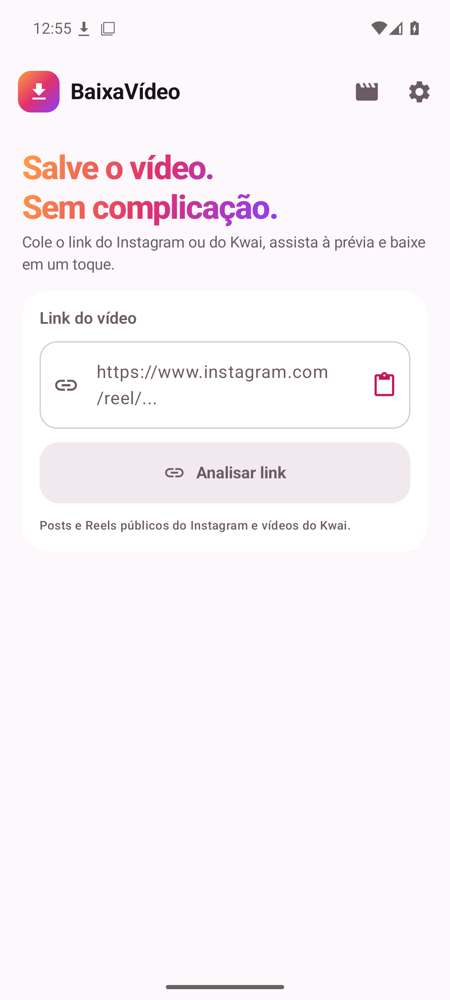

# BaixaVídeo

Aplicativo Android para baixar vídeos do **Instagram** e do **Kwai** a partir de
um link. Cole o link, veja a prévia do vídeo no player e só então baixe — em
qualidade original, sem marca d'água adicional.

<p align="center">
  
  
  
</p>

## Funcionalidades

- **Colar link** com um toque (ou digitando) — aceita links de `instagram.com/p`,
  `/reel`, `/reels`, `/tv` e `kwai.com`, `k.kwai.com`, `kwai.app`.
- **Prévia antes de baixar** com player embutido (ExoPlayer), capa, autor,
  duração e seletor de qualidade quando o site oferece mais de uma.
- **Download em segundo plano** pelo DownloadManager: continua se você sair do
  app, aparece na notificação e é retomado se a conexão cair.
- **Meus vídeos**: biblioteca dos arquivos salvos com miniatura, tamanho e data;
  abrir, compartilhar e excluir.
- **Compartilhar para o app**: recebe links enviados de outros aplicativos
  (Instagram → Compartilhar → BaixaVídeo).
- **Ajustes**: servidor de extração opcional e cookie do Instagram para quando a
  plataforma exigir login.
- Tema claro/escuro, Material 3 e nada de anúncios ou rastreamento.

Os arquivos ficam em **`Filmes/BaixaVideo`** e aparecem na galeria.

## Como a extração funciona

O app resolve tudo no próprio aparelho, sem depender de serviços de terceiros:

| Plataforma | Estratégia |
|---|---|
| **Kwai** | A página do vídeo entrega o MP4 no HTML (`<a-video-player src=…>`). O app segue o link curto (`k.kwai.com`), pega o vídeo principal (ignorando recomendações) e usa capa/título do Open Graph. |
| **Instagram** | A página de *embed* (`/embed/captioned/`) entrega o JSON completo do post — inclusive `video_url` — quando a requisição vem com User-Agent de iPhone ou de robô de indexação. O app tenta iOS, depois Googlebot, depois a API interna (com cookie) e, por fim, as tags Open Graph. |

### Limitações reais (leia antes de usar)

- **Posts privados** e conteúdo removido nunca são acessíveis.
- O Instagram passou a exigir login em boa parte dos acessos. Quando isso
  acontece, o app avisa e você tem duas saídas:
  1. **Cookie `sessionid`** de uma conta sua, colado em *Ajustes* (o app usa esse
     cookie nas chamadas à API interna);
  2. **Servidor de extração** próprio (pasta [`backend/`](backend/)) com
     `yt-dlp` — mais confiável e também cobre outros sites.
- Instagram e Kwai mudam o layout com frequência. Os extratores foram testados
  em novembro de 2026; se pararem de funcionar, a atualização é pontual nos
  arquivos `data/resolver/*.kt` (ou use o backend, que se atualiza via `yt-dlp`).

## Requisitos

- Android 8.0 (API 26) ou superior.
- Android SDK 36, JDK 17+ e Gradle 8.13 (o wrapper já cuida do Gradle).

## Instalando no aparelho

O APK assinado pronto para uso fica em `dist/`:

```bash
adb install -r dist/BaixaVideo-1.0.0.apk
sha256sum -c dist/BaixaVideo-1.0.0.apk.sha256   # confere a integridade
```

Também é possível copiar o APK para o celular e abrir o arquivo (é preciso
autorizar "instalar apps desconhecidos" para o app de arquivos). Na primeira vez
que abrir **Meus vídeos**, o Android pede acesso a fotos e vídeos — sem essa
permissão a lista fica vazia, mas o download continua funcionando.

## Compilando

```bash
./gradlew assembleDebug          # APK de teste
./gradlew assembleRelease        # APK assinado (usa keystore.properties)
./gradlew bundleRelease          # AAB para a Play Store
./gradlew testDebugUnitTest      # testes de unidade
```

O APK de release sai em `app/build/outputs/apk/release/`.

### Assinatura

Copie `keystore.properties.example` para `keystore.properties` e aponte para a
sua chave:

```properties
storeFile=keystore/baixavideo-release.jks
storePassword=...
keyAlias=baixavideo
keyPassword=...
```

O arquivo `keystore.properties` e a pasta `keystore/` estão no `.gitignore`.
**Guarde a senha e o `.jks`**: sem eles não é possível publicar atualizações.

## Servidor de extração (opcional)

```bash
cd backend
docker compose up -d --build
```

Depois, em *Ajustes* do app, informe `http://SEU_IP:8000/resolve`. Detalhes,
cookies e publicação fora da rede local em [`backend/README.md`](backend/README.md).

## Estrutura

```
app/src/main/java/com/cleber/baixavideo/
├── MainActivity.kt                 # entrada, edge-to-edge, link compartilhado
├── BaixaVideoApplication.kt        # DataStore + Coil (miniaturas de vídeo)
├── data/
│   ├── MediaRepository.kt          # orquestra extratores nativos e o backend
│   ├── DownloadRepository.kt       # DownloadManager + progresso
│   ├── LibraryRepository.kt        # MediaStore (Meus vídeos)
│   ├── SettingsStore.kt            # DataStore
│   ├── model/ResolvedMedia.kt      # mídia resolvida + variantes
│   └── resolver/                   # Instagram, Kwai e servidor remoto
├── net/Http.kt                     # OkHttp compartilhado
├── ui/                             # Compose: Home, Biblioteca, Ajustes
└── util/                           # links, HTML/JSON, formatação, intents
backend/                            # FastAPI + yt-dlp (opcional)
```

## Privacidade e uso responsável

O app não envia seus links para nenhum servidor por padrão: Instagram e Kwai são
acessados diretamente do seu aparelho. Se você configurar um servidor de
extração, os links passam a ser enviados para ele.

Baixe apenas vídeos seus ou que você tenha autorização para usar. Respeite os
direitos autorais e os Termos de Uso das plataformas.
