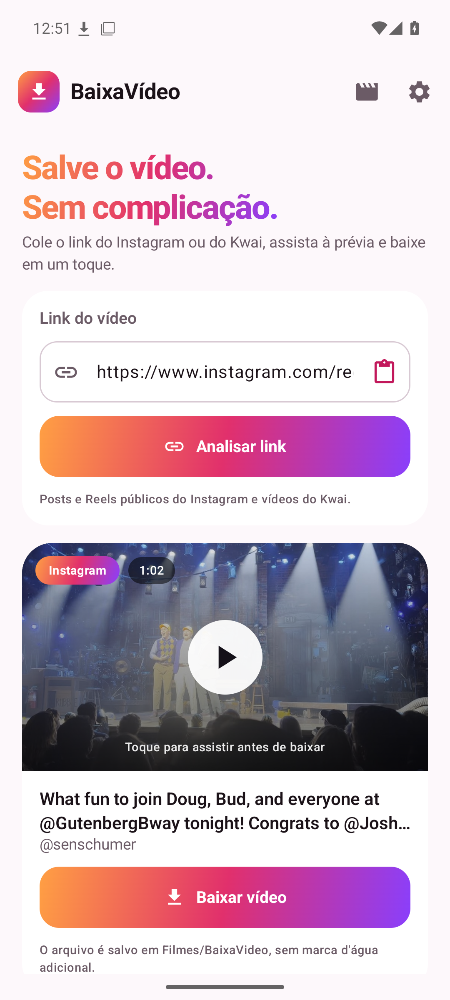
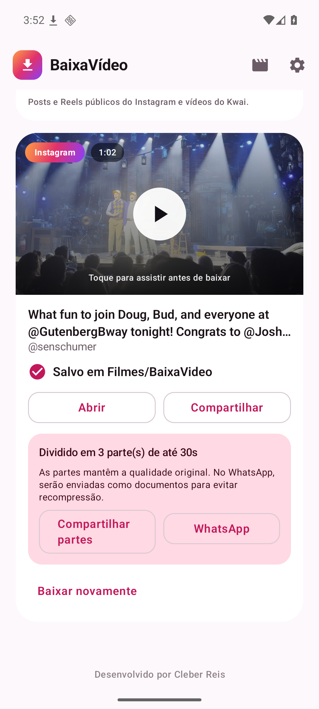
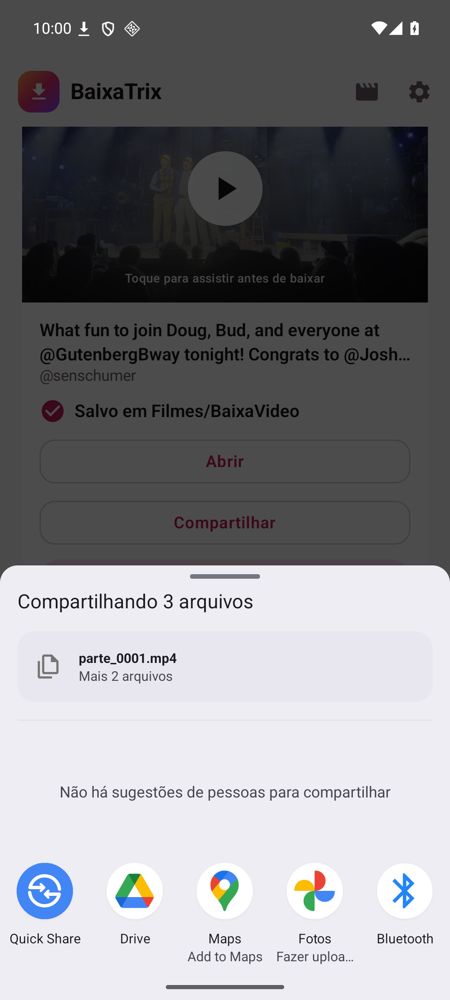

# BaixaTrix

Aplicativo Android para baixar vídeos do **Instagram**, **Kwai** e **YouTube** a
partir de um link. Cole o link, veja a prévia do vídeo no player e só então
baixe. Links públicos do YouTube são extraídos no próprio aparelho, sem configurar
servidor ou conta. Esse suporte é para uso pessoal fora da Play Store.

O projeto está licenciado sob **GPL-3.0-or-later**; consulte [`LICENSE`](LICENSE)
e [`THIRD_PARTY_NOTICES.md`](THIRD_PARTY_NOTICES.md).

<p align="center">
  
  
  
</p>

<p align="center">
  
  
</p>

<p align="center">
  <a href="https://github.com/clebersys/baixatrix/releases/latest">Baixar o APK</a> ·
  <a href="docs/privacidade.html">Política de privacidade</a> ·
  <a href="store/publicacao-play.md">Publicação na Play Store</a>
</p>

## Funcionalidades

- **Colar link** com um toque (ou digitando) — aceita links de `instagram.com/p`,
  `/reel`, `/reels`, `/tv`, `kwai.com`, `k.kwai.com`, `kwai.app` e links do
  Kwai Lite (`kwai-video.com/p/...`), além de vídeos e Shorts do YouTube.
- **Prévia antes de baixar** com player embutido (ExoPlayer), capa, autor,
  duração e seletor de qualidade quando o site oferece mais de uma.
- **Download em segundo plano** pelo DownloadManager: arquivos diretos continuam
  se você sair do app e aparecem na notificação. Se o YouTube exigir combinação
  de faixas, mantenha o BaixaTrix aberto até o MP4 ficar pronto.
- **Baixar e dividir em partes de 30s**: corta o vídeo nos keyframes sem
  reencodificar, preservando a qualidade original. Depois, envia todas as partes
  juntas para outro app ou para o WhatsApp como documentos (sem recompressão).
- **Meus vídeos**: biblioteca dos arquivos salvos com miniatura, tamanho e data;
  abrir, compartilhar e excluir.
- **Compartilhar para o app**: recebe links enviados de outros aplicativos
  (Instagram → Compartilhar → BaixaTrix).
- **Sobre**: pasta de downloads, orientações de uso e versão do aplicativo.
- Tema claro/escuro, Material 3 e nada de anúncios ou rastreamento.

Os arquivos ficam em **`Filmes/BaixaTrix`** e aparecem na galeria.
As partes divididas ficam no armazenamento específico do app até serem
compartilhadas; mantenha o BaixaTrix aberto enquanto o processamento termina.

## Como a extração funciona

Instagram, Kwai e YouTube são resolvidos no próprio aparelho com seus respectivos
extratores:

| Plataforma | Estratégia |
|---|---|
| **Kwai / Kwai Lite** | Os links do Kwai Lite redirecionam para o Kwai. A página entrega o MP4 no HTML (`<a-video-player src=…>`); o app pega o vídeo principal (ignorando recomendações) e usa capa/título do Open Graph. |
| **Instagram** | Para posts públicos, o app tenta a página de *embed* (`/embed/captioned/`) e as tags Open Graph. O app não solicita, aceita nem lê cookies ou `sessionid` do Instagram. |
| **YouTube** | O NewPipe Extractor obtém localmente os metadados e streams públicos. O app baixa MP4 progressivo ou combina localmente H.264/HEVC + AAC sem reencodificar; não pede servidor, login ou cookies. |

### Limitações reais (leia antes de usar)

- **Posts privados não são suportados pelo BaixaTrix.** O app não solicita,
  aceita nem importa cookies ou `sessionid` do Instagram.
- Alguns posts **públicos** podem não ser resolvidos se o Instagram exigir login.
- A extração de YouTube depende das interfaces públicas usadas pelo NewPipe
  Extractor e pode parar quando o YouTube muda essas interfaces. O app combina
  somente faixas H.264/HEVC + AAC compatíveis, sem reencodificar; se não houver um
  formato aceito, ele informa a limitação. Não acessa vídeos privados.
- Ao combinar faixas do YouTube, mantenha o BaixaTrix aberto até o fim do
  processamento.
- Instagram e Kwai mudam o layout com frequência. Os extratores foram testados
  em novembro de 2026; se pararem de funcionar, a atualização é pontual nos
  arquivos `data/resolver/*.kt`.

## Requisitos

- Android 8.0 (API 26) ou superior.
- Android SDK 36, JDK 17+ e Gradle 8.13 (o wrapper já cuida do Gradle).

## Instalando no aparelho

O APK pessoal assinado da versão 2.4.0 está na
[GitHub Release](https://github.com/clebersys/baixatrix/releases/tag/v2.4.0):

```text
BaixaTrix-2.4.0.apk
BaixaTrix-2.4.0.apk.sha256
```

Se você tiver os artefatos em `dist/`, instale e confira assim:

```bash
adb install -r dist/BaixaTrix-2.2.0.apk
sha256sum -c dist/BaixaTrix-2.2.0.apk.sha256   # confere a integridade
```

**BaixaTrix 2.0.0 usa um novo identificador Android**
(`com.cleber.baixatrix`). Ele é instalado como um app separado do antigo
BaixaVídeo; a pasta de download também mudou para `Filmes/BaixaTrix`.

Também é possível copiar o APK para o celular e abrir o arquivo (é preciso
autorizar "instalar apps desconhecidos" para o app de arquivos). Na primeira vez
que abrir **Meus vídeos**, o Android pede acesso a fotos e vídeos — sem essa
permissão a lista fica vazia, mas o download continua funcionando.

A versão mais recente também está em
[Releases](https://github.com/clebersys/baixatrix/releases/latest).

## Compilando

```bash
./gradlew assembleDebug          # APK de teste
./gradlew assembleRelease        # APK assinado (usa keystore.properties)
./gradlew bundleRelease          # AAB para a Play Store
./gradlew testDebugUnitTest      # testes de unidade
```

O APK de release sai em `app/build/outputs/apk/release/`.

### Assinatura

Copie `keystore.properties.example` para `keystore.properties` e aponte para a
sua chave:

```properties
storeFile=keystore/baixavideo-release.jks
storePassword=...
keyAlias=baixavideo
keyPassword=...
```

O arquivo `keystore.properties` e a pasta `keystore/` estão no `.gitignore`.
**Guarde a senha e o `.jks`**: sem eles não é possível publicar atualizações.

## Estrutura

```
app/src/main/java/com/cleber/baixatrix/
├── MainActivity.kt                 # entrada, edge-to-edge, link compartilhado
├── BaixaTrixApplication.kt         # Coil e inicialização do NewPipe Extractor
├── data/
│   ├── MediaRepository.kt          # orquestra os resolvedores
│   ├── DownloadRepository.kt       # download e publicação no MediaStore
│   ├── LibraryRepository.kt        # MediaStore (Meus vídeos)
│   ├── model/ResolvedMedia.kt      # mídia resolvida + variantes
│   ├── processing/                 # divisão e mux local de vídeo
│   └── resolver/                   # Instagram, Kwai, YouTube e downloader NewPipe
├── net/Http.kt                     # OkHttp e User-Agents
├── ui/                             # Compose: Home, Biblioteca, Configurações
└── util/                           # links, HTML/JSON, formatação, intents
backend/                            # ferramenta opcional de desenvolvimento; não usada pelo app
```

## Licenças

O NewPipe Extractor é distribuído sob GPL-3.0-or-later e usado somente para
extração local. O app não utiliza cookies nem solicita login no YouTube.

## Publicação

O suporte local ao YouTube da versão 2.4.0 é distribuído para uso pessoal no
GitHub, fora da Play Store. Os materiais abaixo ainda descrevem a publicação
anterior; não envie essa versão à Play Store.

O pacote para a Play Store está pronto:

- **AAB assinado**: `dist/BaixaTrix-2.2.0.aab` (`./gradlew bundleRelease`)
- **Ficha pronta** (título, descrições, categoria, Data safety): [`store/ficha-play.md`](store/ficha-play.md)
- **Artes**: ícone 512, gráfico de destaque 1024×500 e capturas em [`store/`](store/)
- **Passo a passo do Play Console**: [`store/publicacao-play.md`](store/publicacao-play.md)

> A versão 2.0.0 usa o novo `applicationId` `com.cleber.baixatrix`. Se o antigo
> BaixaVídeo já tiver uma ficha no Play Console, esta versão precisa ser criada
> como um app/listing separado — não pode atualizar o pacote antigo.

A política de privacidade é publicada pelo GitHub Pages em
<https://clebersys.github.io/baixatrix/privacidade.html>.

## Privacidade e uso responsável

Instagram, Kwai e YouTube são acessados diretamente do aparelho. O BaixaTrix não
envia links ou arquivos a um backend próprio e não solicita cookies ou login do
YouTube. A pasta `backend/` é uma ferramenta opcional e não participa dos
downloads do app.

Baixe apenas vídeos seus ou que você tenha autorização para usar. Respeite os
direitos autorais e os Termos de Uso das plataformas.
